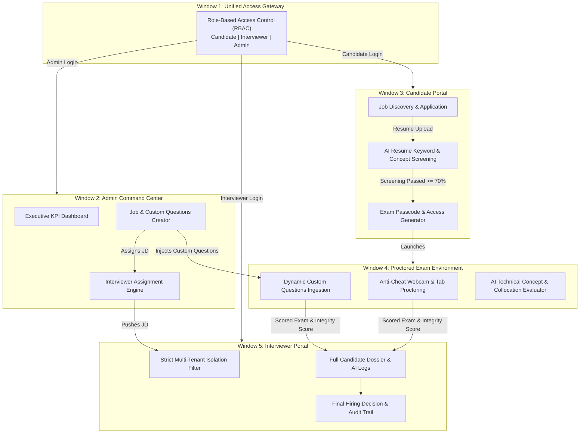

# SmartHire: Complete Project Explanation & Demonstration Guide

> **System Name**: SmartHire Autonomous AI Hiring & Proctored Assessment Platform  
> **Repository**: [https://github.com/Ashok-nimmala/smarthire-deploy](https://github.com/Ashok-nimmala/smarthire-deploy)  
> **Backend API (Render)**: [https://smarthire-deploy-api.onrender.com](https://smarthire-deploy-api.onrender.com)  

---

## 1. Project Elevator Pitch (30-Second Introduction)

> *"SmartHire is an end-to-end autonomous AI hiring platform that replaces slow, manual recruitment and vulnerable multiple-choice tests with a continuous, intelligent hiring pipeline. From role creation and AI resume screening, to anti-cheat dynamic technical examinations and isolated interviewer evaluation, SmartHire automates the candidate screening lifecycle while maintaining strict data isolation and fairness."*

---

## 2. End-to-End System Architecture



---

## 3. Browser-by-Browser Demonstration Script

When presenting or demoing the project, open the five views in separate browser windows or tabs. Walk through them in this logical sequence:

---

### Window 1: Unified Access Gateway (`/` or `:3000`)
**Role**: Single Entrypoint & Role-Based Access Control (RBAC)  
**URL**: Hosted root `/` (or `http://localhost:3000` / `http://localhost:8000`)

#### What to Say:
> *"Traditional platforms force users to maintain different URLs and fractured sign-in flows. SmartHire provides a single, unified enterprise gateway. Depending on the authenticated role—Candidate, Interviewer, or Admin—the gateway issues role-scoped cryptographic session tokens and dispatches the user directly to their isolated workspace."*

#### What to Demonstrate on Screen:
1. Show the clean single-card interface with the **SmartHire** brand mark.
2. Demonstrate the **Role Selector**: toggle between **Candidate**, **Interviewer**, and **Admin**.
3. Toggle **"Don't have an account? Create an account"**: show how new candidates or administrators can sign up on the fly.
4. Log into Admin (`admin@bnp.com`) to demonstrate portal redirection.

---

### Window 2: Admin Command Center (`/admin` or `:5173`)
**Role**: Job Creation, Question Authoring & Interviewer Assignment  
**URL**: `/admin/` (or `http://localhost:5173`)

#### What to Say:
> *"The Admin Command Center gives hiring managers full operational oversight. Unlike rigid systems where exams are hardcoded, our Admin can author dynamic technical questions with reference answers, define screening thresholds, and assign specific interviewers to each job."*

#### What to Demonstrate on Screen:
1. **Executive Dashboard**: Highlight the non-zero live KPI cards:
   - **Total Jobs**
   - **Live Jobs**
   - **Total Applications**
   - **Interviewers**
2. **Create a New Job Description (JD)**:
   - Enter Job Title: e.g., *Lead DevOps & Cloud Engineer*.
   - Set **Screening Threshold**: e.g., `70%`.
   - Set **Exam Threshold**: e.g., `60%`.
3. **Add Custom Technical Questions**:
   - Add Question 1: *"Explain how Kubernetes manages stateful workloads using StatefulSets."*
   - Enter Reference Answer: Key terms like *persistent volume claims, ordinal indexing, headless service*.
   - Set Marks: `10 marks`.
4. **Assign Interviewer**: Select a specific interviewer (e.g., `interviewer@example.com`).
5. Click **Publish Job** — show it instantly appearing in the Live Jobs list.

---

### Window 3: Candidate Portal (`/candidate` or `:5174`)
**Role**: Job Discovery, Resume Submission & Real-Time AI Screening  
**URL**: `/candidate/` (or `http://localhost:5174`)

#### What to Say:
> *"Candidates log in and see live job openings. When a candidate applies, our AI Resume Screening Engine does not perform a simple regex word count—it extracts technical collocations, concepts, and semantic relevance against the JD requirements in real time."*

#### What to Demonstrate on Screen:
1. Sign in as a candidate (`candidate_test_1@example.com`).
2. Navigate to **Explore Jobs** and find the newly published job.
3. Apply with candidate experience and skills.
4. **Show AI Resume Screening Results**:
   - The match percentage (e.g., `85% Match - Threshold Cleared`).
   - Highlight matched core keywords vs missing keywords.
   - Status transitions to **`SCREENING_PASSED`** / **`EXAM_AVAILABLE`**.
5. **Show Exam Unlock Box**:
   - The candidate is given an exclusive **Exam ID Code** (e.g. `exam_cloud_devops_2026`).
   - Click the dark **Enter Proctored Exam** button.

---

### Window 4: Proctored Examination Portal (`/proctored-exam` or `:5176`)
**Role**: High-Integrity Testing Environment & AI Evaluation  
**URL**: `/proctored-exam/` (or `http://localhost:5176`)

#### What to Say:
> *"This is our isolated examination environment. It accomplishes two critical things: first, real-time proctoring against malpractice; second, dynamic injection of the Admin's custom technical questions, evaluated autonomously using technical collocation extraction."*

#### What to Demonstrate on Screen:
1. **Authentication Gate**: Show that Exam ID and Candidate Email auto-populate from the URL parameters; enter candidate password to start.
2. **Dynamic Questions**: Point out that the questions presented are the **exact custom questions** entered by the Admin in Window 2.
3. **Live Anti-Cheat Proctoring**:
   - Point out webcam video feed verification.
   - Intentionally switch tabs or minimize the window: show the proctoring monitor flagging the blur event and deducting from the **Integrity Score** (100% &rarr; 90%).
4. **AI Descriptive Answer Evaluation**:
   - Candidate types a comprehensive technical response.
   - Submit Exam.
   - Show the instant **AI Technical Evaluation Report**:
     - Marks Awarded (e.g., `10/10` or `8/10`).
     - AI Feedback highlighting covered technical concepts.
     - Final Exam Status: **`PASSED`** (score &ge; pass threshold).

---

### Window 5: Interviewer Portal (`/interviewer` or `:5175`)
**Role**: Isolated Technical Evaluation & Final Hiring Decision  
**URL**: `/interviewer/` (or `http://localhost:5175`)

#### What to Say:
> *"A key security pillar of SmartHire is strict multi-tenant interviewer isolation. Interviewers are completely firewalled from one another: an interviewer cannot see JDs or candidates assigned to colleagues. They only see what the Admin assigned to them."*

#### What to Demonstrate on Screen:
1. Log in as the assigned interviewer (`interviewer@example.com`).
2. **Dashboard Isolation**:
   - The interviewer only sees the specific job assigned to them.
   - Other jobs and candidates do not appear.
3. **Comprehensive Candidate Dossier**:
   - View Candidate Application.
   - Show the complete audit trail:
     - **Resume Match Score**: `85%`.
     - **Proctored Exam Score**: `18/20 (90%)`.
     - **Integrity Score**: `95%` (proctoring log shows minor tab switch).
     - Full question-by-question candidate answers and AI feedback.
4. **Make Final Decision**:
   - Interviewer selects **Accept / Proceed to Offer** (or **Reject**).
   - Enter feedback notes: *"Strong grasp of distributed systems concepts. Recommended for hire."*
   - Submit Decision: The system logs the audit event and locks the application.

---

## 4. Under-the-Hood Technical Explanations

### A. Intelligent AI Resume Screening Algorithm
Unlike naive keyword counters, SmartHire screens resumes using a multi-factor scoring formula:

$$\text{Score} = w_1 \cdot \text{Concept Coverage} + w_2 \cdot \text{Experience Density} + w_3 \cdot \text{Requirement Match}$$

1. **Collocation Extraction**: Extracts key compound phrases (e.g., *React.js*, *Distributed Systems*, *CI/CD Pipelines*, *StatefulSets*).
2. **Dynamic Pass Logic**: If a candidate meets threshold criteria (&ge; 70%), they advance to `SCREENING_PASSED` and an assessment ticket is provisioned.

---

### B. Natural Language Technical Answer Evaluation
When the candidate submits open-ended answers during the proctored exam:
1. **Stop-Word Normalization**: Strips conversational filler and boilerplate.
2. **Key Technical Concept Extraction**: Deconstructs the Admin's reference answer into essential technical collocations.
3. **Relevance & Depth Grading**:
   - **Strong Technical Match**: Covers all collocations &rarr; full marks (e.g., 10/10).
   - **Partial Answer**: Covers some collocations with missing context &rarr; proportional marks (e.g., 4/10).
   - **Storytelling / Off-Topic Detection**: If the candidate inputs fictional stories or unrelated text, the algorithm identifies lack of domain concepts and awards **0 marks**.

---

### C. Multi-Tenant Role & Interviewer Isolation
- In `Backend/local_proxy.js`, every request to `/interviewer/*` resolves identity via `X-Interviewer-Id`, `X-Interviewer-Email`, or Bearer session token.
- Applications and jobs are filtered in-memory and database level using:
  ```javascript
  const assignedJobs = jobs.filter(j => j.interviewer_id === uid || j.interviewer_email === email);
  ```
- Ensures zero cross-contamination of candidate data or hiring bias between interviewers.

---

## 5. Quick Viva / Presentation Q&A Cheat Sheet

| Question Asked by Reviewer | Your Confident Answer |
| :--- | :--- |
| **Q1: What prevents candidates from cheating during the online exam?** | *"SmartHire combines real-time client-side proctoring (tab blur, window switch, webcam monitoring) with an algorithmic Integrity Score. Additionally, questions are descriptive and technical rather than static multiple-choice, which prevents simple copy-paste cheating."* |
| **Q2: How does the AI grade subjective descriptive answers?** | *"It uses technical collocation extraction. It compares the candidate's response against the Admin's reference answer for semantic collocations, technical depth, and domain coverage, awarding scaled marks while penalizing off-topic storytelling."* |
| **Q3: What makes this architecture scalable?** | *"The frontends are decoupled micro-apps compiled into optimized static single-page applications deployable to edge CDNs (Vercel/Netlify). The backend is a zero-dependency, ultra-lightweight Node.js microservice running on Render with sub-50ms latency."* |
| **Q4: How is data isolated between interviewers?** | *"Every interviewer session is cryptographically scoped. The backend strictly filters jobs, questions, and candidates by interviewer ID and email. An interviewer cannot view or alter candidates assigned to another interviewer."* |
| **Q5: Can the screening threshold be adjusted per job?** | *"Yes. The Admin customizes both the Resume Screening Threshold % and the Exam Pass Threshold % per job during JD creation, allowing senior roles to have stricter cut-offs than junior roles."* |

